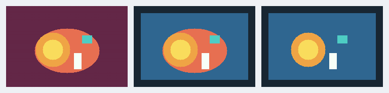

# 材质继承级联与逐像素归因

这个示例把“父类材质、实例材质、本地意见”放在同一条可审计的解析链上。正确强度固定为：

```text
local > instance > inherited
```

`inherited` 内部再按继承距离决定：离实例最近的父类材质优先，根类材质最后兜底。实例上的直接覆盖必须高于从父类继承来的值，不能反过来。



从左到右：继承前、覆盖后、强制回落（负向对照）。

## 场景

继承链为 `vessel -> alloy -> stone`，实例是 `vessel#1`：

| 层 | 来源 | 覆盖区域 | 材质 |
|---|---|---|---|
| inherited depth=0 | `vessel` | 自身无材质，继续向上 | — |
| inherited depth=1 | `alloy` | 内面板 | `#2F6690` |
| inherited depth=2 | `stone` | 全画布 | `#182632` |
| instance | `vessel#1` | 中央椭圆 | `#E76F51` |
| local | 本地意见 A-D | 光环、核心、火花块、高光条 | `#EFA445` / `#F9DC5C` / `#4ECDC4` / `#F7FFF7` |

本地意见始终最强；在同一区域内，`local:core` 的 salience 又高于 `local:halo`。

## 三种渲染

| 模式 | 级联 | 用途 | 相对正确图的错误像素 |
|---|---|---|---|
| `before_inheritance` | `local > instance > unresolved` | 关闭继承层，暴露只能由父类材质补上的区域 | 29558 |
| `after_override` | `local > instance > inherited` | 正确结果，作为审计基准 | 0 |
| `forced_fallback` | `local > inherited > instance` | 故意反转 instance/inherited，作为回归负向对照 | 4417 |

强制回落中，实例椭圆被最近的父类材质 `inherited:alloy.panel` 覆盖，因此中央 4417 个非本地像素从正确的 `#E76F51` 变成 `#2F6690`。这不是生产级联，而是专门用来证明错误可以被逐像素定位。

`before_inheritance` 中没有材质覆盖的像素使用两种棋盘格诊断色：

- `diagnostic:unresolved-even`：`#56223E`
- `diagnostic:unresolved-odd`：`#702B4F`

它们也是报告中的最终 opinion 记录，`layer` 为 `diagnostic`。

## 逐像素追溯

每张图都有同名 provenance JSON，例如：

- `out/02_after_override.png`
- `out/after_override.provenance.json`

报告中的查找契约是：

```text
pixel(x,y) = opinions[winner_slots[y][x]]
```

每个 opinion 记录包含最终 ID、层、材质、颜色、来源、继承深度、salience、覆盖形状、有效强度和判定理由。因此 PNG 中任一像素的颜色都能对应到恰好一个最终 opinion。

`out/audit.json` 以 `after_override` 为基准，按“实际最终 opinion + 期望最终 opinion”分组列出所有错误像素。例如强制回落只有一组：

```text
actual:   inherited:alloy.panel  #2F6690
expected: instance:vessel.ember  #E76F51
count:    4417
```

组内 `pixel_indices` 使用：

```text
index = y*width + x
x = index % width
y = index / width
```

因此错误颜色不是模糊的“某处不对”，而是能落到具体像素、具体层、具体最终 opinion。诊断像素也有对应的最终诊断 opinion，不会出现无法归因的颜色。

## 运行

只使用 Go 标准库，无第三方依赖：

```bash
go test ./...
go run . -out out
```

输出：

```text
out/01_before_inheritance.png
out/02_after_override.png
out/03_forced_fallback.png
out/contact_sheet.png
out/before_inheritance.provenance.json
out/after_override.provenance.json
out/forced_fallback.provenance.json
out/audit.json
```

核心实现：

- `scene.go`：继承链、实例与本地 opinion
- `resolve.go`：强度计算和逐像素胜者选择
- `provenance.go`：颜色到最终 opinion 的索引报告
- `audit.go`：相对正确渲染的错误分组与像素归因
- `render.go`：PNG 与三图拼版

测试会固定检查继承深度、`instance > inherited`、`local` 最强、强制回落的覆盖方向、每个像素的 opinion/颜色/rank 一致性，以及审计组中每个像素索引确实指向声明的最终 opinion。
